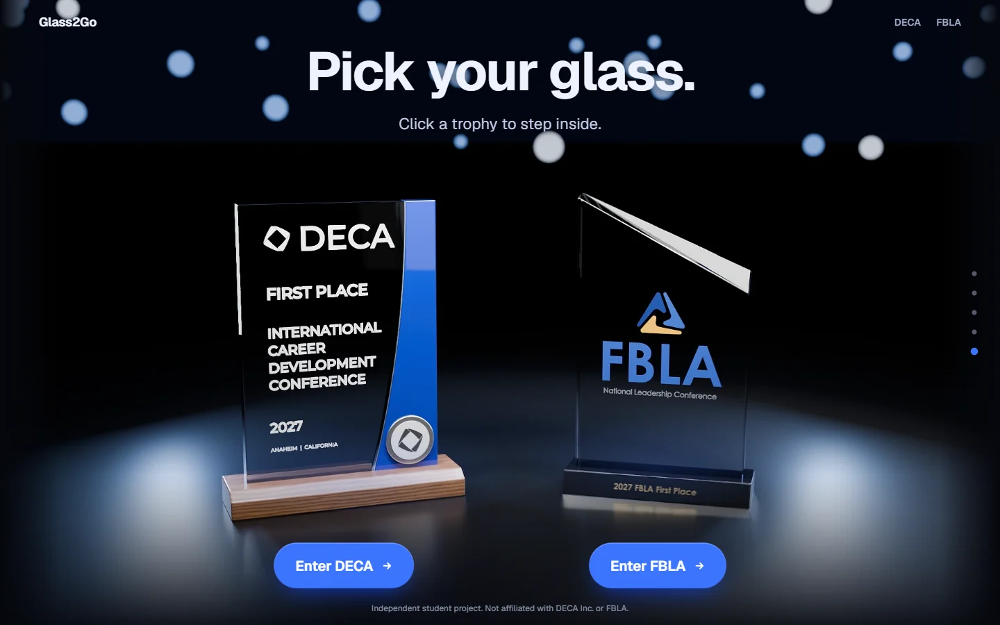
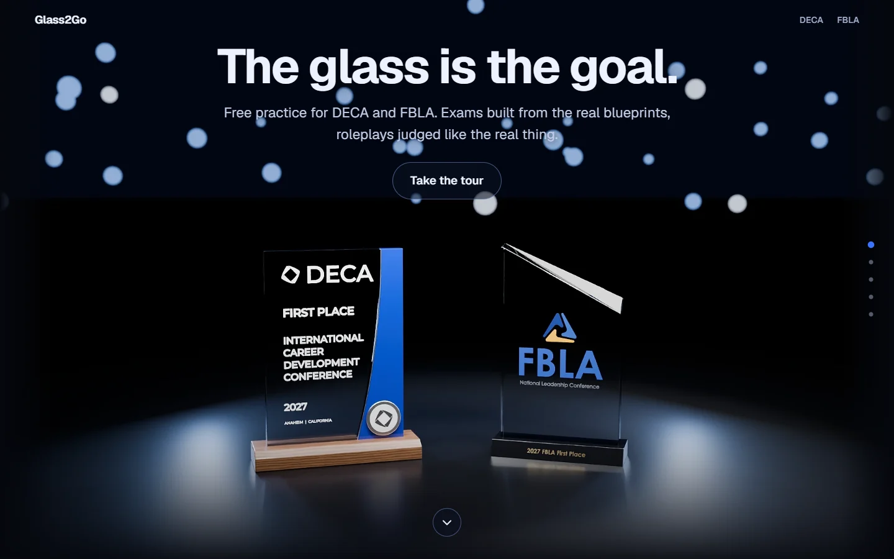
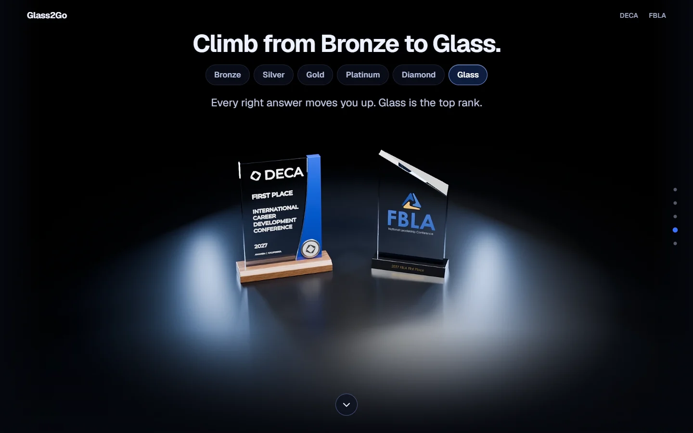
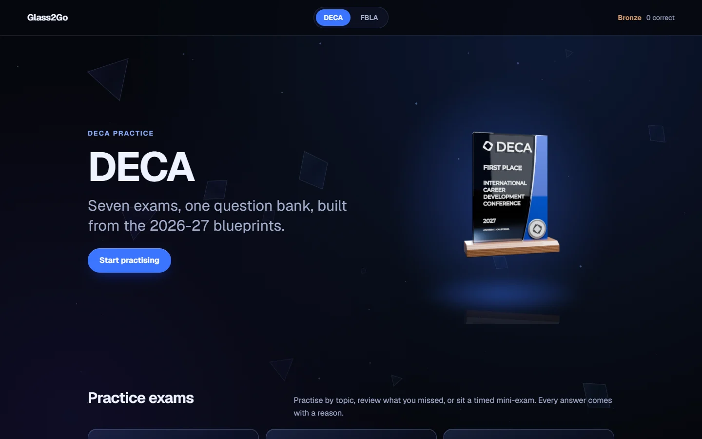
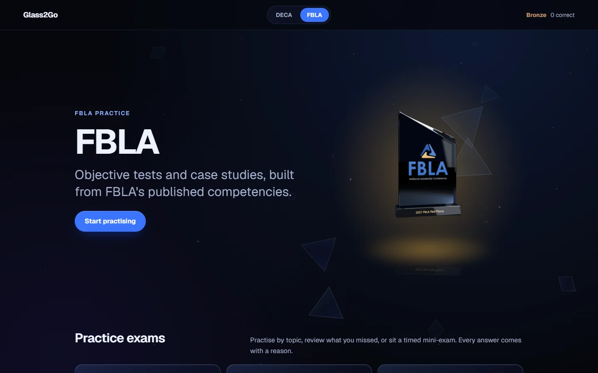
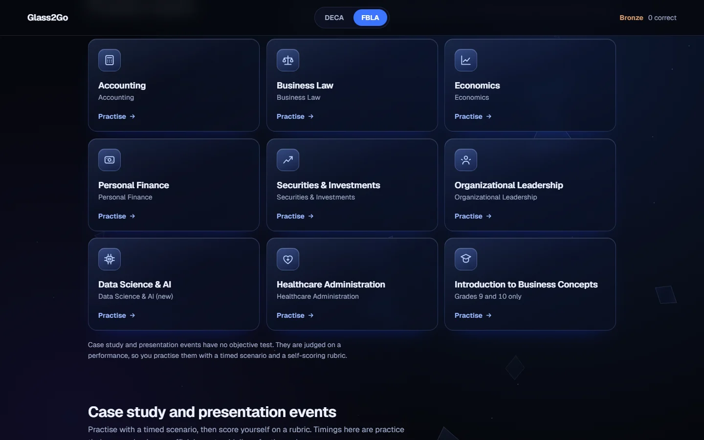
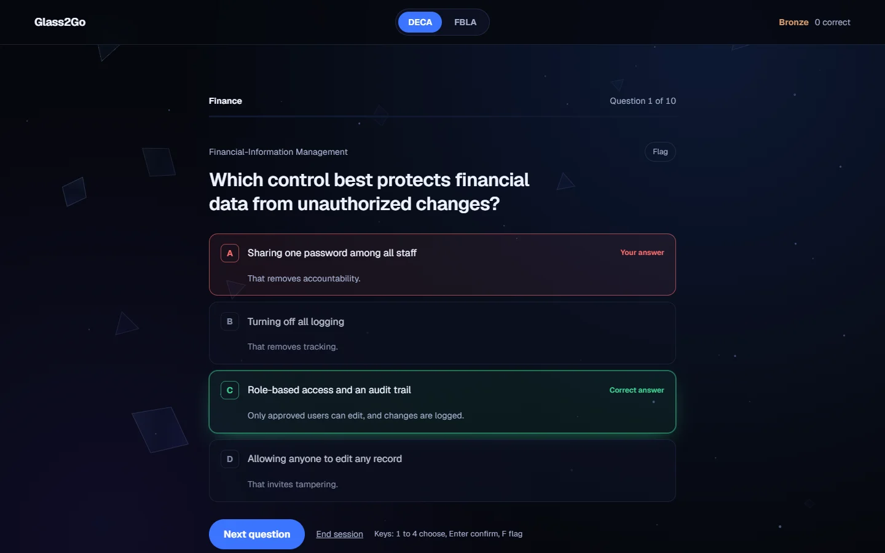

<div align="center">



# Glass2Go

**Free practice for DECA and FBLA.**<br>
Exams built from the published blueprints, a reason behind every answer, and roleplays scored on a rubric.

[](https://dheerajallam29.github.io/glass2go/)
[](https://github.com/dheerajallam29/glass2go/actions/workflows/pages.yml)
[](LICENSE)


</div>

> **Independent student project.** Not affiliated with DECA Inc., FBLA or FBL Canada. Every question and scenario is
> original practice material, written with AI and not yet reviewed by an official source. Practice only; scores are not
> predictions of competition results.

## A look around

| | |
|---|---|
|  |  |
| **A film for a homepage.** Five stops rendered in Blender, played at 48 fps. | **Climb from Bronze to Glass.** Every right answer moves you up. |
|  |  |
| **DECA.** A turntable trophy that follows your cursor. | **FBLA.** Same page, gold glow, its own nine objective tests. |
|  |  |
| **Glass exam tiles** with a light that follows the pointer. | **A reason behind every option**, right or wrong. |

Click a trophy on the homepage and the camera dives through its glass into that competition.

## What is inside

- **About 4,900 practice questions.** Seven DECA clusters (Core, Business Management, Finance, Hospitality, Marketing,
  Entrepreneurship, Personal Financial Literacy) and nine FBLA objective tests. Each question has one right answer and a
  short explanation for every option.
- **Practice that adapts.** Study by topic, redo what you missed, review on a spaced schedule (1, 2, 4, 7 and 14 days),
  flag questions for later, or sit a timed mini-exam. Progress, ranks and topic mastery stay in your browser.
- **DECA role-plays.** All 28 role-play events by career cluster (Principles, Individual Series, Team Decision Making, Personal Financial Literacy), five original scenarios each. Prep, then present to your camera with the prompt hidden, then answer the judge, then watch yourself back and score the 2026-27 rubric out of 100. Recordings stay in your browser.
- **FBLA case studies and presentations.** Timed prep and present phases with a self-scoring rubric.
- **Feedback that feels good.** Ripples and sparkles on right answers, streak badges, and glass that shatters on a
  strong score, over floating glass shards that drift with your mouse and scroll.
- **Accessible by default.** Keyboard control throughout, and every animation respects *reduce motion*.

## Repository layout

```text
glass2go/
├── web/                 The Next.js site
│   ├── src/app          Routes (home, /deca, /fbla, practice, events, roleplay)
│   ├── src/components   home film, practice quiz, roleplay runner, fx (curtain, shards, bursts), site UI
│   ├── src/lib          questions, progress and ranks, event scenarios
│   ├── src/data         bank.json, the built question bank
│   ├── public           film frames (48 fps WebP tiers) and transparent trophy renders
│   └── scripts          Playwright checks, screenshot capture, GitHub Pages build
├── data/                Question source (JSONL), role-play scenarios (data/roleplays), exam definitions, validation report, CSV export
├── tools/               Question-bank builder and audits, frame interpolation
├── blender/             flight.py renders the film, tilt crops and trophy hero shots
├── trophy_preview/      build_trophies.py builds the two trophy models; logos used on them
├── docs/images/         README screenshots and the social preview image
└── .github/workflows/   GitHub Pages deploy
```

## Run it locally

```bash
cd web
npm install
npm run dev            # http://localhost:3000
```

| Command | What it does |
|---|---|
| `npm run build` | Server build, including the live question generator |
| `npm run build:pages` | Static export for GitHub Pages, served from `/glass2go` |
| `node scripts/serve-pages.mjs` | Serve `out/` the way Pages will |
| `node scripts/verify-practice.mjs <url>` | Browser check of the practice flow |
| `node scripts/verify-motion.mjs <url>` | Browser check of the film and the zoom transition |

## The question bank

Questions live as JSONL in `data/questions/`, one file per batch, and are validated and built into the site:

```bash
node tools/build-bank.mjs
```

The builder enforces four options per question with a reason for each, rejects duplicates and "all/none of the above",
places answers evenly across A to D, and flags answer-length bias and weak wording. Results go to
`web/src/data/bank.json`, `data/bank-report.md` and `data/exports/glass2go-question-bank.csv`.

### Role-plays

Scenarios live in `data/roleplays/<event>.jsonl` and are validated against the 2026-27 format (indicator counts, two judge questions, strong-answer notes):

```bash
node tools/build-roleplays.mjs
```

Performance indicators come from DECA's public lists (`tools/parse-pis.mjs` builds `data/roleplays/pi-bank.json`). The Core and Marketing lists are the official ones; for the other clusters some indicators are written in the same style.

### Live question generator (optional)

The server build can write five fresh questions on demand. Copy `web/.env.example` to `web/.env.local` and set
`ANTHROPIC_API_KEY`. Generated questions are marked unreviewed and never count toward rank. The GitHub Pages version is
static, so it hides this feature.

## Deployment

Pushes to `main` build the static site and publish it with GitHub Actions to
**https://dheerajallam29.github.io/glass2go/**. The repo needs **Settings → Pages → Source: GitHub Actions** once.

## Re-rendering the film (optional, slow)

`renders/` is not committed. `blender/render_all.sh` produces the 24 fps masters (hours on a laptop), and
`tools/interp/run.cjs` interpolates them to 48 fps WebP tiers in `web/public/flight/`. `blender/flight.py --mode hero`
renders the transparent trophy shots used on the DECA and FBLA pages.

## License

[MIT](LICENSE). DECA and FBLA names and logos belong to their owners and appear only to identify the competitions.
